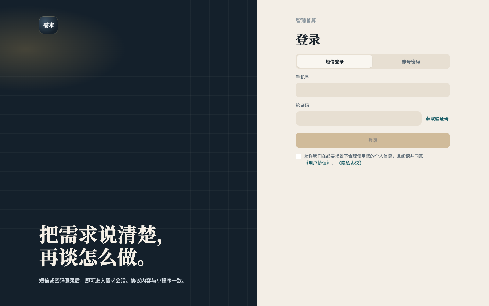
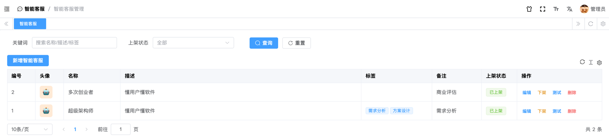
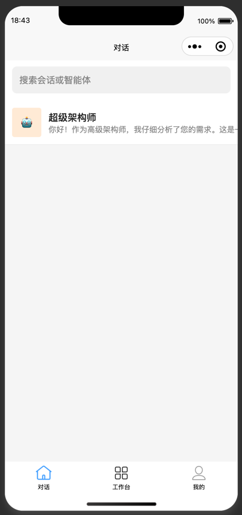
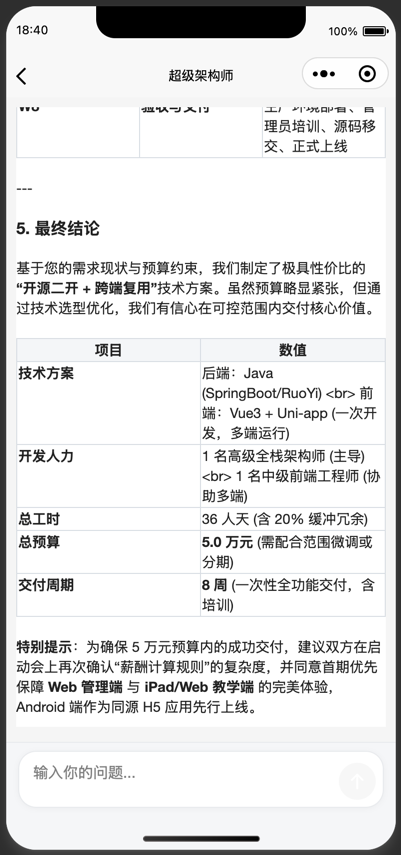

# hipp-or

智臻善算 **智能需求分析**：把需求说清楚，再谈怎么做。

在 [kinit](https://github.com/vvandk/kinit) 基础上扩展 **用户端（hipp-web / hipp-uni）**、**管理端（hipp-admin）** 与 **后端 API（hipp-api）**。对话经服务端接入 Dify；密钥不下发客户端。钱包与登录身份对接 **hipp-manager**（产品码 `or`）。




现网用户端：`http://hipp.site/or/` · 管理端：`http://hipp.site/or/manager/`

---

## 仓库结构

| 目录 | 说明 |
|:---|:---|
| `hipp-api/` | FastAPI：认证、管理业务、`/mp/chat` 对话、钱包透传、电商短链履约 |
| `hipp-web/` | Vue 用户端（主交付）：登录、需求会话、附件、分享、账户充值 |
| `hipp-admin/` | Vue 管理端：智能客服 / Dify、计费、人工客服、电商履约 |
| `hipp-uni/` | uni-app 小程序：对话收件箱、场景咨询、「我的」 |
| `doc/` | 需求 `01-or`、设计 `02-dr`、测试 `03-tr`、运维 `99-ops` |

---

## 用户端能力（hipp-web）

| 能力 | 说明 |
|:---|:---|
| 登录 | 短信 / 账号密码；协议与小程序一致；同站可与 `/mgr/` 等 SSO |
| 需求会话 | 侧栏「最近 / 归档」；WebSocket 流式回复，失败回退 HTTP；深度思考可折叠 |
| 附件 | 图片与文档上传（平台媒体）；粘贴 / 拖拽；业务错误带稳定 `code` |
| 分享 / 归档 | 话题结束后可分享只读链接；可归档并查看 token 消耗 |
| 账户 | `/wallet` 余额、充值（支付码弹窗）、订单与流水；会话按配置扣费 |
| 短链次卡 | `/a/{token}` 免登录做 1 次需求分析（电商 / 线下出链） |

首版侧栏仅「需求」；商业评估由 `SHOW_BUSINESS_SCENE` 控制。开发：

```shell
# 先启动 hipp-api（默认 http://127.0.0.1:46000）
cd hipp-or/hipp-web
npm install
npm run dev
# http://127.0.0.1:5173 ；Vite 将 /api 反代到 46000
```

生产构建须带子路径，例如 `VITE_BASE_PATH=/or/`、`VITE_API_BASE=/or/api`（见运维说明，勿写死外网主机名）。

---

## 智能体与对话 API

### 配置（管理端 → 库）

表 **`vadmin_agent`**：`api_server`（须含 `/v1`）、`app_key`（仅服务端）、`status`（`draft` / `published`）。管理接口前缀 **`/vadmin/agent`**。



### 客户端对话

- 前缀 **`/mp/chat`**；鉴权 `Authorization: Bearer <access_token>`
- 客户端**不得**传 Dify 地址或密钥；服务端按 `agent_id` 读取并调用
- 主路径：Dify Chat **`response_mode=streaming`**（SSE / WS）；`blocking` 降级
- 业务失败返回稳定 **`code` + `message`**（如余额不足 `46005`），见 `doc/02-dr/04 小程序对话/mp_chat业务错误码.md`

### 环境变量（摘录）

见 `hipp-api/.env.example`：

| 变量 | 用途 |
|:---|:---|
| `HIPP_DIFY_HTTPX_VERIFY` | 调 Dify 是否校验证书（内网自签可 `false`） |
| `HIPP_MANAGER_BASE` / `HIPP_MANAGER_KEY` | 对接 hipp-manager（登录校验、钱包、媒体） |
| `HIPP_OR_ACCESS_BASE` | 短链次卡对外基址（如 `https://hipp.site/or/a`） |

---

## 小程序（hipp-uni）

- 默认进入对话收件箱；API 封装在 `hipp-uni/common/request/api/mp/chat.js`
- TabBar：**对话 / 工作台 / 我的**
- 与 Web 共用后端 `/mp/chat`；Web 独有能力（如 `include_open=1` 最近会话）不强制对齐小程序

历史界面参考（小程序）：

 

---

## 生产部署（路径约定）

同站子路径部署时（示例现网）：

| 入口 | 路径 |
|:---|:---|
| 用户端 | `/or/` → `hipp-web` 静态 |
| 管理端 | `/or/manager/` → `hipp-admin` 静态 |
| API | `/or/api/` → 本机 API（如 `46010`），Nginx 去掉前缀 |
| 产品静态 | `/or/media/` → `hipp-api/static/` |
| 对话附件 | 站点 `/media/...` → hipp-manager 公共媒体 |
| WebSocket | 同 `/or/api/.../ws`，须 Upgrade |

supervisor 启动 API（安装：`python3 -m pip install supervisor`）。Nginx 片段示意（按实际路径替换）：

```nginx
# 用户端
location /or/ {
    alias /data/or/hipp-web/;
    try_files $uri $uri/ /or/index.html;
}

# 管理端
location /or/manager/ {
    alias /data/or/hipp-admin/;
    try_files $uri $uri/ /or/manager/index.html;
}

location /or/media/ {
    alias /data/or/hipp-api/static/;
    expires 30d;
}

location /or/api/ {
    proxy_pass http://127.0.0.1:46010/;
    proxy_set_header Host $host;
    proxy_set_header X-Real-IP $remote_addr;
    proxy_set_header X-Forwarded-For $proxy_add_x_forwarded_for;
    proxy_set_header X-Forwarded-Proto $scheme;
    proxy_http_version 1.1;
    proxy_set_header Upgrade $http_upgrade;
    proxy_set_header Connection "upgrade";
}
```

更完整的现网步骤见运维侧部署说明（勿把密钥写进本 README）。

---

## 文档索引

| 主题 | 路径 |
|:---|:---|
| Web 用户端 | `doc/02-dr/06 Web端/Web用户端设计.md` |
| 个人资金账户 | `doc/02-dr/06 Web端/个人资金账户设计.md` |
| 电商短链次卡 | `doc/02-dr/06 Web端/电商短链次卡设计.md` |
| Dify 智能体管理 | `doc/02-dr/03 智能客服管理/Dify智能体接入管理设计.md` |
| 对话与流式 | `doc/02-dr/04 小程序对话/小程序用户对话设计.md` |
| 多模态附件 | `doc/02-dr/04 小程序对话/多模态附件与语音输入设计.md` |
| 测试设计 | `doc/03-tr/03 智能客服管理/`、`04 小程序对话/`、`06 Web端/` |

---

## 特别感谢 kinit

本项目基于 [kinit](https://github.com/vvandk/kinit) 二次开发。
