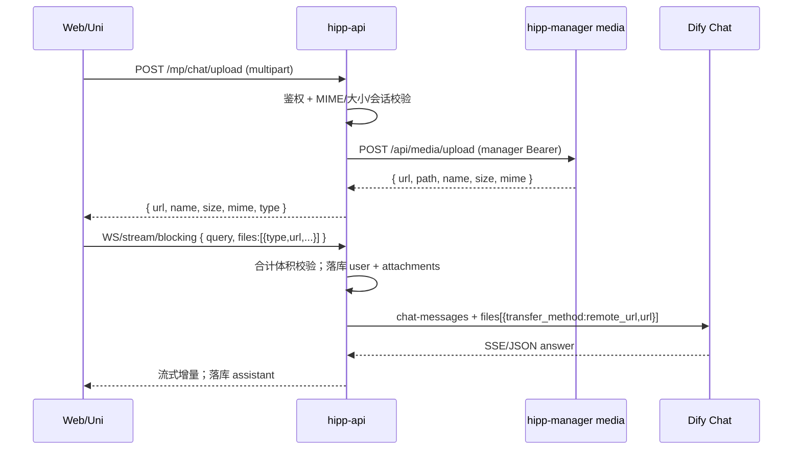

# 关联文档

| 类型 | 文档路径 |
|:---|:---|
| 原始需求 | `hipp-or/doc/01-or/【对话】多模态附件与语音输入.md` |
| 关联需求 | `hipp-or/doc/01-or/【小程序对话】用户智能对话——后端处理.md` |
| 关联需求 | `hipp-or/doc/01-or/【Web端】用户对话与场景咨询.md` |
| 关联设计 | `hipp-or/doc/02-dr/04 小程序对话/小程序用户对话设计.md` |
| 关联设计 | `hipp-or/doc/02-dr/06 Web端/Web用户端设计.md` |
| 实施方案 | `hipp-or/doc/02-dr/04 小程序对话/【对话】多模态附件与语音输入实施方案.md` |
| 测试设计 | `hipp-or/doc/03-tr/04 小程序对话/多模态附件与语音输入测试设计.md` |
| 平台媒体 | `hipp-manager/doc/02-dr/04 媒体/公共媒体上传设计.md` |
| Dify 参考 | `hipp-or/doc/01-or/Dify API对接参考.md` |
| Dify 导出 | 多模态 **v2**：`study/配置信息/生产-yin/dify/v2/需求分析.yml`、`v2/商业评估.yml`；纯文字 **v1**：`v1/需求分析.yml`、`v1/商业评估.yml`；说明见 `导入说明.md` |

# 功能设计

## 总体数据流



## 约束常量（与 Dify 取更严）

产品硬约束：**单次消息附件总体积 &lt; 20MB**。

Dify 应用当前导出中的参考上限（落地前以已发布应用为准，变更须同步常量）：

| 项 | 参考值 | 产品侧策略 |
|:---|:---|:---|
| 单图 | 10MB | 单图 ≤10MB |
| 单文档 | 15MB | 单文档 ≤15MB |
| 单次个数 | 3 | ≤3 |
| 合计 | （Dify 无「合计 20MB」项） | 额外强制合计 &lt;20MB |
| 传递方式 | local_file / remote_url | **优先 remote_url** |

后端校验顺序：类型白名单 → 单文件上限 → 个数 → 本轮合计 &lt;20MB。

## 后端（hipp-api）

### 上传

- 门面：`POST /mp/chat/upload`（`AllUserAuth`），`multipart/form-data`，字段 `file`。
- 可选 query/form：`session_id`（若传则校验会话归属且为可发送的 dify 会话）。
- 存储：**转发 hipp-manager** `POST /api/media/upload`（`product=or`，`prefix=chat`），使用服务端缓存的 `manager_token`；不再直连本产品 `ALIYUN_OSS`。
- 平台设计见 `hipp-manager/doc/02-dr/04 媒体/公共媒体上传设计.md`。
- 返回示例：`{ type, name, size, mime, url }`，其中 `type` 映射为 Dify 的 `image` / `document`（本版无 audio/video 入 `files`）；`url` 为 manager 返回的绝对地址（如 `https://hipp.site/media/or/...`）。
- 音频若仅用于 STT：可另接口 `POST /mp/chat/audio-to-text`（multipart），返回 `{ text }`，不强制落媒体盘。
- 删除门面：`DELETE /mp/chat/upload`（JSON `{ url }`），用 `manager_token` 调 manager `DELETE /api/media`；Web/Uni 待发列表移除时必须调用。
- 话题结束清理：结题后**保留**本会话消息 `attachments` 中的全部 URL（历史/分享须可看原图）；助手正文中的 `/media/` 引用一并纳入保留。不再因「未出现在助手正文」删盘。待发取消仍 `DELETE /mp/chat/upload`；无引用落盘靠孤儿 GC。
- **全站孤儿 GC**：`hipp-api` 启动事件挂后台循环；每日 `Asia/Shanghai` 约 03:00（可用 `HIPP_OR_MEDIA_GC_HOUR`，默认 3）执行一次：从全库消息收集保留 URL（全部 `attachments` + 助手正文 `/media/`），Redis 锁 `or:media_orphan_gc:{yyyyMMdd}`，再调 manager `POST /api/s2s/media/gc`（`product=or`，`prefix=chat`，`min_age_hours` 默认 24，可用 `HIPP_OR_MEDIA_GC_MIN_AGE_HOURS`）。`HIPP_OR_MEDIA_GC=0` 可关闭。

### 发送载荷

扩展 `SendMessageIn`：

| 字段 | 说明 |
|:---|:---|
| `query` | 文本；允许空字符串，当且仅当 `files` 非空 |
| `files` | 可选；元素含 `type`、`url`（平台媒体绝对 URL）、`name`、`size`、`mime` |

WS 首包 JSON、blocking、stream 三路径读取同一结构。`query` 为空且有附件时，转 Dify 的 `query` 使用固定占位（如「请结合附件内容回答」），落库用户 `content` 可用占位或空+附件摘要策略（实现取一，前后端一致）。

Dify body 增量：

```json
"files": [
  {
    "type": "image",
    "transfer_method": "remote_url",
    "url": "https://hipp.site/media/or/.../xxx.png"
  }
]
```

`dify_client.iter_dify_chat_stream` / `send_chat_message_blocking` 增加可选 `files` 参数。

降级：配置开关（如环境变量）为 true 时，服务端对每个文件 `POST /v1/files/upload` 后改用 `local_file` + `upload_file_id`。

### 数据模型

**方案 A（推荐）**：`vadmin_chat_message` 增加 `attachments` JSON（Text/JSON）列，结构为数组：

`[{ "type","name","size","mime","url" }]`

助手消息该字段为空。无 DB 外键。

**预览**：`last_message_preview` 规则——有附件时优先 `[图片]` / `[文件] {name}`，可再截取文本前缀。

迁移：`versions_dev` / `versions_pro` 各一份，仅加可空列。

### 历史与分享

- `ChatMessageOut` / `ShareMessageOut` 增加可选 `attachments`。
- 分享页：图片可展示缩略图；文档展示文件名与外链（同域或 OSS）。

### 人工客服

`send_human_text` 本版不接受 `files`；传入则 400。

## 前端

### 共用交互

- 输入区：附件按钮 → 选图/选文件；待发列表可删；发送前本地合计校验。
- 气泡：用户侧渲染附件；助手仍 Markdown。
- 语音：按住/点击录音 → 调 `audio-to-text` → 填入输入框或直接发送（产品默认：**填入输入框供确认**）。

### hipp-web

- `ChatPane` / `useChatThread` / `stream.js`：上传后带 `files`；历史渲染 `attachments`。
- `ChatPane` 输入区：`paste` / `dragenter|dragover|drop` 收集剪贴板或拖入文件，经 `chatAttach.collectTransferFiles` 规范化后走与点选相同的 `uploadChatFile` + 待发列表；拖入时显示「松开以添加」遮罩；类型/个数/体积仍走 `assertAttachList`。

### hipp-uni

- `subpkg/chat/chat.vue` 与场景页输入区：`chooseImage` / `chooseMessageFile`、`uni.uploadFile`；录音用小程序录音 API。
- 真机注意：选文件类型受微信能力限制，文档以平台允许为准并提示。

## Dify 应用（运营配置，非代码）

对「需求分析」「商业评估」（详见 `study/配置信息/生产-yin/dify/导入说明.md`）：

1. `features.file_upload.enabled=true`；`allowed_file_types` 含 `image`、`document`；扩展名对齐产品白名单；保留 `remote_url`。
2. **附件链路（v2 现网）**：有附件 → Code 读 md/txt（无「文档提取」节点）→ 有正文则原文进摘要；否则筛图片 → 视觉/文本「附件解析」→ 写入 `attach_digest` 与本轮 `attach_turn`；**收集关 vision**，跨轮只读紧凑 `survey_state`，仅当轮有新附件读 `attach_turn`；**方案/评估**读累积 `attach_digest` + 调查表。细则见 `study/配置信息/生产-yin/dify/导入说明.md`。
3. PDF：无内置整文件转图；文本不足且无图时摘要可标 `【需补图】`。需转页图时自接工具或让用户截图。
4. 按需 `speech_to_text.enabled=true`。
5. 限额：单图/单文件不低于产品校验侧；发布后回写 `study/配置信息/生产-yin/dify/v2/*.yml`。
6. 提示词分「附件解析 / 收集 / 方案(或评估)」三份；收集输出含 `finish` / `info` / `state`（`state`→`survey_state`）；仍遵守 JSON/`结束状态` 契约。

# 约束与边界

- 密钥不出客户端；OSS 凭据仅服务端。
- OSS URL 须 Dify 可达；私有桶用短时签名 URL（过期时间覆盖一轮推理）。
- 不改变扣费、话题结束、结束状态过滤。
- Scope out：视频、人工客服附件、原生音频多模态理解。
